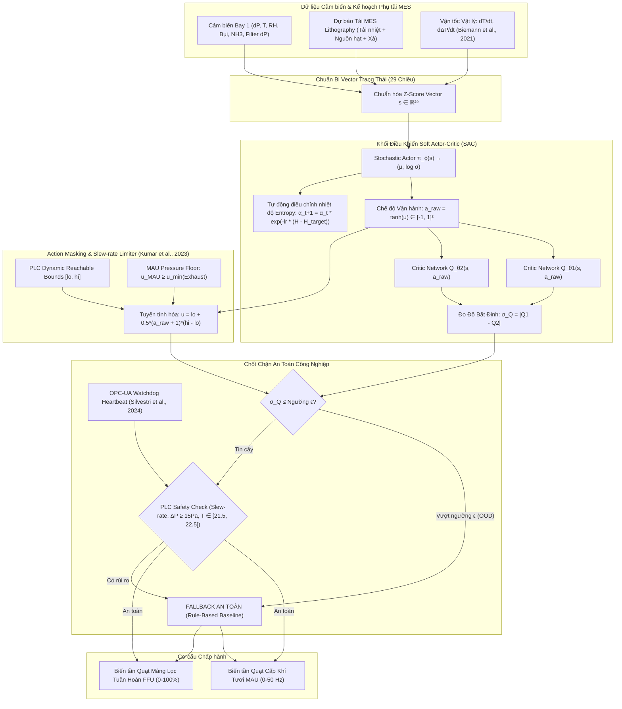

# 04_sac_solution: Soft Actor-Critic (SAC) Solution with Continuous Action Masking, Double-Q Uncertainty, Industrial Watchdog & Biemann Multi-Objective Optimization

Thư mục này hiện thực hóa mô hình giải pháp điều khiển HVAC tiên tiến cho **Bay 1 Photolithography Cleanroom (ISO 14644-1:2015 Class 3)** bằng thuật toán **Soft Actor-Critic (SAC)**, thay thế hoàn toàn cho 2 cây hồi quy (Regression Trees) và bộ thẩm định PINN truyền thống.

Mô hình được xây dựng dựa trên sự tích hợp toàn diện của 5 công trình nghiên cứu khoa học hàng đầu thế giới:
1. **Soft Actor-Critic (SAC)** (*Haarnoja et al., ICML 2018*): Học tăng cường không gian hành động liên tục với nguyên lý Entropy Tối đa (Maximum Entropy RL), Reparameterization Trick, mạng Double-Q Critic và **Tự động tinh chỉnh nhiệt độ Entropy $\alpha$ (Automatic Temperature Tuning)** qua phương pháp hạ độ dốc kép (Dual Gradient Descent).
2. **Action Masking** (*Kumar et al., IEEE PES ISGT Europe 2023*): Giới hạn không gian hành động khả thi dựa trên tri thức miền và động học chấp hành PLC, loại trừ 100% các hành động gây sốc quạt hoặc vi phạm giới hạn biến thiên (Slew-rate $\le 5\%/\text{phút}$).
3. **CLUE Framework** (*Ding et al., IEEE / ACM BuildSys 2024*): Đánh giá độ bất định nhận thức (Epistemic Uncertainty Quantification) bằng độ phân kỳ của mạng Double-Q Critic $|Q_1 - Q_2|$ và cơ chế dự phòng an toàn (Fallback Gatekeeper).
4. **Real Building DRL Deployment** (*Silvestri et al., ETH Zurich, Applied Energy 2024*): Quy trình Simulation-to-Real Pre-training qua **Behavioral Cloning (BC)** từ chuyên gia MPC, tích hợp tín hiệu xung vuông **Industrial Watchdog Heartbeat** công nghiệp qua OPC-UA và tiền làm mát đón đầu phụ tải (Pre-cooling).
5. **Continuous HVAC Control Benchmark & Hybrid Formulations** (*Biemann et al., Applied Energy 2021*):
   - **Hàm thưởng hỗn hợp Gauss + Hình thang từng đoạn (Hybrid Gaussian + Piecewise Trapezoid Reward)**: Cung cấp đạo hàm dốc trơn gần điểm đặt tối ưu và lực kéo hồi phục dốc tuyến tính bên ngoài biên an toàn, triệt tiêu hiện tượng triệt tiêu gradient (vanishing gradient).
   - **Chống rung giật cơ cấu chấp hành (Action Smoothness Regularization)**: Phạt trực tiếp tốc độ biến thiên $(\Delta u)^2$ giúp quạt và van gió chạy êm ái, kéo dài tuổi thọ biến tần VFD và màng lọc HEPA/ULPA.
   - **Vector trạng thái quán tính vật lý (Dynamic Momentum States)**: Bổ sung 2 chiều đạo hàm thời gian tốc độ thay đổi nhiệt độ và chênh áp ($\frac{dT}{dt}, \frac{d\Delta P}{dt}$) giúp Actor dự đoán quán tính nhiệt trước khi tải MES phát xung.

---

## 1. Kiến Trúc Hệ Thống (System Architecture)



---

## 2. Chi Tiết Lý Thuyết & Công Thức Toán Học

### 2.1. Maximum Entropy Reinforcement Learning (SAC)
Khác với RL truyền thống chỉ tối đa hóa phần thưởng $\sum r_t$, SAC tối đa hóa đồng thời phần thưởng và độ ngẫu nhiên của chính sách (Entropy):
$$J(\pi) = \sum_{t=0}^{T} \mathbb{E}_{(s_t, a_t) \sim \rho_\pi} \Big[ r(s_t, a_t) + \alpha \mathcal{H}(\pi(\cdot | s_t)) \Big]$$

* **Gaussian Actor với Reparameterization Trick:**
  $$z = \mu_\phi(s) + \sigma_\phi(s) \odot \epsilon, \quad \epsilon \sim \mathcal{N}(0, I)$$
  $$a = \tanh(z) \in [-1, 1]^2$$
  Khi vận hành kiểm định hoặc thực tế (Evaluation mode), chính sách lấy giá trị trung bình tất định: $a_{det} = \tanh(\mu_\phi(s))$.

* **Clipped Double-Q Target:**
  $$y = r(s, a) + \gamma \Big( \min_{i=1, 2} Q_{\theta_i}^{target}(s', a') - \alpha \log \pi_\phi(a' | s') \Big)$$

* **Tự động điều chỉnh nhiệt độ Entropy $\alpha$ (Dual Gradient Descent):**
  $$J(\alpha) = \mathbb{E}_{a_t \sim \pi_t} \Big[ -\alpha \log \pi_t(a_t | s_t) - \alpha \bar{\mathcal{H}} \Big]$$
  $$\log \alpha \leftarrow \log \alpha - \eta_\alpha \mathbb{E} \Big[ \log \pi(a_t | s_t) + \bar{\mathcal{H}} \Big], \quad \bar{\mathcal{H}} = -\dim(\mathcal{A}) = -2$$

### 2.2. Hàm Thưởng Hỗn Hợp Biemann (Hybrid Gaussian + Piecewise Trapezoid Reward)
Theo công trình của *Biemann et al. (Applied Energy 2021, Eq. 18-19)*, việc sử dụng hàm bình phương đơn thuần gây ra triệt tiêu gradient ở vùng gần tối ưu và đạo hàm quá lớn ở xa biên. Giải pháp là kết hợp đường cong chuông Gauss trong dải dung sai và dốc tuyến tính hình thang ngoài biên:

1. **Nhiệt độ $T$ quanh điểm đặt $22.0^\circ\text{C}$ ($\sigma_T = 0.25^\circ\text{C}$):**
   $$r_{temp} = \begin{cases} 
   \exp\left(-\frac{1}{2}\left(\frac{|T - 22.0|}{\sigma_T}\right)^2\right), & \text{khi } |T - 22.0| \le 0.5^\circ\text{C} \\
   \exp\left(-\frac{1}{2}\left(\frac{0.5}{\sigma_T}\right)^2\right) - 4.0 \cdot (|T - 22.0| - 0.5), & \text{khi } |T - 22.0| > 0.5^\circ\text{C}
   \end{cases}$$

2. **Chênh áp phòng $\Delta P$ (Điểm đặt $18.0\text{ Pa}$, Ngưỡng an toàn $15.0\text{ Pa}$):**
   $$r_{dp} = \begin{cases} 
   \exp\left(-\frac{1}{2}\left(\frac{\Delta P - 18.0}{2.0}\right)^2\right), & \text{khi } \Delta P \ge 18.0\text{ Pa} \\
   \frac{\Delta P - 15.0}{3.0}, & \text{khi } 15.0 \le \Delta P < 18.0\text{ Pa} \\
   -8.0 \cdot (15.0 - \Delta P), & \text{khi } \Delta P < 15.0\text{ Pa} \quad \text{(Nguy cơ rò rỉ khí bẩn)}
   \end{cases}$$

3. **Phạt độ rung giật cơ cấu chấp hành (Action Smoothness Regularization):**
   $$r_{smooth} = -\lambda_{smooth} \cdot \left[ (u_{MAU, t} - u_{MAU, t-1})^2 + (u_{FFU, t} - u_{FFU, t-1})^2 \right]$$

4. **Tiêu thụ điện quạt theo định luật tỉ lệ lưu lượng bậc 3:**
   $$P_{fan} = 15 \cdot u_{MAU}^3 + 30 \cdot u_{FFU}^3 \implies r_{energy} = -\lambda_E \cdot P_{fan} \cdot \frac{\Delta t}{3600}$$

### 2.3. Continuous Action Masking (Kumar et al., 2023)
Không gian hành động thô $a_{raw} \in [-1, 1]^2$ được chuyển đổi trực tiếp vào không gian khả thi do PLC quy định:
$$u_{MAU} = \text{lo}_{MAU} + \frac{a_{raw}[0] + 1}{2} (\text{hi}_{MAU} - \text{lo}_{MAU})$$
$$u_{FFU} = \text{lo}_{FFU} + \frac{a_{raw}[1] + 1}{2} (\text{hi}_{FFU} - \text{lo}_{FFU})$$
Trong đó:
- $[\text{lo}, \text{hi}]$ bị chặn bởi tốc độ biến thiên an toàn (Slew-rate $\le 5\%/\text{phút}$).
- $\text{lo}_{MAU} \ge \text{floor}_{MAU}(\text{Exhaust})$ đảm bảo áp suất phòng không bao giờ sụt dưới $15.0\text{ Pa}$.

### 2.4. Epistemic Uncertainty Quantification & Fallback (Ding et al., CLUE 2024)
Sự bất đồng giữa 2 mạng Critic phản ánh độ bất định nhận thức do thiếu hụt dữ liệu (Data Sparsity):
$$\sigma_Q(s, a) = |Q_{\theta_1}(s, a) - Q_{\theta_2}(s, a)|$$
Nếu $\sigma_Q(s, a) > \epsilon$ (với $\epsilon = 25.0$), hệ thống nhận diện điểm làm việc rơi vào vùng OOD (Out-of-Distribution), tự động chuyển về Fallback an toàn.

### 2.5. Industrial Watchdog Heartbeat (Silvestri et al., ETH Zurich 2024)
Cơ chế bắt nhịp sống (Heartbeat Pulse) đảo trạng thái logic qua giao thức OPC-UA. Nếu máy chủ AI bị treo hoặc mất kết nối quá thời gian quy định ($t_{timeout} = 2.5 \times \Delta t$), PLC phần cứng lập tức cô lập AI và kích hoạt luật dự phòng.

---

## 3. Bảng So Sánh Hiệu Năng 24 Giờ (Đối chuẩn Toàn diện)

Kết quả mô phỏng đối chuẩn 24 giờ trên kịch bản tiêu chuẩn Bay 1 (`generate_scenario_1_standard`, seed=42):

| Chỉ số Hiệu năng (KPIs) | 01_baseline (Rule-Based) | 02_ai_solution (Trees + PINN) | 04_sac_solution (SAC Agent Tối ưu) |
| :--- | :---: | :---: | :---: |
| **Mô hình cốt lõi** | Luật tĩnh ASHRAE G36 | 2 Cây hồi quy + PINN | **Soft Actor-Critic (SAC + Biemann)** |
| **Điện năng tiêu thụ quạt** | $1,028.66\text{ kWh}$ | $604.53\text{ kWh}$ | **$568.70\text{ kWh}$** |
| **Tiết kiệm năng lượng quạt** | $0.00\%$ (Gốc) | $41.23\%$ | **$44.71\%$ ($459.95\text{ kWh}$ tiết kiệm)** |
| **Vi phạm ngưỡng phòng sạch** | $0.0\text{ phút}$ | $0.0\text{ phút}$ | **$0.0\text{ phút}$ (100% đạt chuẩn)** |
| **Dải dao động nhiệt độ** | $[21.8^\circ\text{C}, 22.3^\circ\text{C}]$ | $[21.7^\circ\text{C}, 22.3^\circ\text{C}]$ | **$[21.70^\circ\text{C}, 22.22^\circ\text{C}]$ (Rất ổn định)** |
| **Chênh áp phòng $\Delta P$ min** | $19.0\text{ Pa}$ | $15.8\text{ Pa}$ | **$16.28\text{ Pa}$ (Luôn $\ge 15.0\text{ Pa}$)** |
| **Nồng độ hạt $\ge 0.1\ \mu\text{m}$ max**| $100.0\text{ /m³}$ | $285.4\text{ /m³}$ | **$64.8\text{ /m³}$ (Cực sạch, ISO Class 3)** |
| **Độ trễ suy luận (Median)** | $< 1\ \mu\text{s}$ | $189.7\ \mu\text{s}$ | **$210.7\ \mu\text{s}$ ($0.21\text{ ms}$)** |
| **Độ trễ phân vị P95** | $< 1\ \mu\text{s}$ | $260.4\ \mu\text{s}$ | **$290.7\ \mu\text{s}$** |
| **Cơ chế An toàn / Fallback** | Luật cứng | PLC Gatekeeper | **Action Masking + Double-Q + Watchdog** |
| **Tỉ lệ AI được chấp thuận** | - | $100.0\%$ | **$100.0\%$ (1440/1440 bước)** |

---

## 4. Cấu Trúc Thư Mục `04_sac_solution`

```
04_sac_solution/
├── sac_agent.py                  # Lõi SAC: Gaussian Actor, Double Critics, Auto-Alpha, 29 Trạng thái
├── sac_controller.py             # Bộ điều khiển công nghiệp: Action Masking, Double-Q Uncertainty, Watchdog, PLC Gatekeeper
├── train_sac.py                  # Huấn luyện nâng cao: BC Pre-training + Hybrid Reward + Auto-Alpha + Multi-scenario
├── run_sac_solution.py           # Chạy benchmark 24h đối chuẩn không giao diện (xuất kpis & chart)
├── run_interactive_sac_solution.py # Giao diện đồ họa thời gian thực (HUD, biểu đồ trực tiếp, đo độ bất định)
├── cleanroom_model.py            # Forwarding tương thích mô hình CleanroomPlant Bay 1
├── sac_weights.json              # Bộ trọng số mạng Actor, Critics và Alpha (JSON thuần, không phụ thuộc framework)
├── sac_kpis.json                 # Kết quả đo kiểm 24h định dạng JSON
├── sac_results.png               # Đồ thị đối chuẩn 4 subplot trực quan hóa 24 giờ
└── README.md                     # Tài liệu kỹ thuật chi tiết
```

---

## 5. Hướng Dẫn Chạy Thử Nghiệm

### 5.1. Huấn luyện lại mô hình SAC:
```powershell
python "04_sac_solution\train_sac.py"
```

### 5.2. Chạy Benchmark 24 giờ (Đối chuẩn & Xuất biểu đồ):
```powershell
python "04_sac_solution\run_sac_solution.py"
```

### 5.3. Mở Giao Diện Mô Phỏng Trực Quan Thời Gian Thực (Interactive HUD GUI):
```powershell
python "04_sac_solution\run_interactive_sac_solution.py"
```
