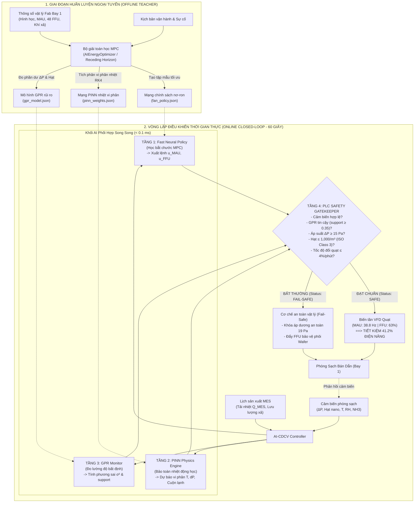

# AI-CDCV: An AI-Driven Demand-Controlled Ventilation Solution for Semiconductor Cleanrooms
### Giải Pháp Thông Gió Theo Nhu Cầu Ứng Dụng Trí Tuệ Nhân Tạo & Cổng An Toàn PLC Cho Phòng Sạch Bán Dẫn 300mm

Dự án nghiên cứu và phát triển giải pháp điều khiển thông gió theo nhu cầu (**Coordinated Demand-Controlled Ventilation - CDCV**) kết hợp **Chính sách nơ-ron học bắt chước ngoại tuyến (Fast Neural Policy)**, **Mạng nơ-ron nhúng tri thức vật lý (PINN)**, **Mô hình hồi quy quá trình Gauss đo lường độ bất định (GPR)** và **Cổng chốt an toàn công nghiệp (PLC Safety Gatekeeper)** cho buồng quang khắc sạch bán dẫn 300mm (Bay 1: Lithography & Track, diện tích $540\text{ m}^2$, thể tích $2,818.8\text{ m}^3$, tiêu chuẩn ISO 14644-1:2015 Class 3).

Mô hình được xây dựng dựa trên các tiêu chuẩn quốc tế và hiệu chuẩn thực nghiệm:
- **Tiêu chuẩn kiểm soát môi trường**: ISO 14644-1:2015 Class 3 (hạt $\ge 0.1\ \mu\text{m} \le 1,000/\text{m}^3$; hạt $\ge 0.5\ \mu\text{m} \le 35/\text{m}^3$), Áp suất dương $\ge 15.0\text{ Pa}$, Nhiệt độ $22.0 \pm 0.3^\circ\text{C}$, Độ ẩm $41.0 \pm 2.0\%$.
- **Kiểm soát AMC (Airborne Molecular Contamination)**: Tiêu chuẩn SEMI F21 với màng lọc hóa học than hoạt tính ($\eta_{\text{chem}} = 95\%$), nồng độ $NH_3 \le 10.0\text{ ppb}$ (vận hành thông thường $\approx 0.10 - 0.23\text{ ppb}$).
- **Hệ thống FFU (48 Quạt Trần)**: Đường đặc tính công suất thực nghiệm ($82.7 - 133.9\text{ W}$ ứng với $0.32 - 0.52\text{ m/s}$), màng lọc HEPA/ULPA hiệu suất $99.999\%$.
- **Cụm xử lý khí tươi MAU (Dual-Coil & Reheat)**: Lưu lượng thiết kế $10,800\text{ m}^3/\text{h}$ ($3.0\text{ m}^3/\text{s}$), quạt $15.5\text{ kW}$ biến tần VFD dải $35 - 50\text{ Hz}$, cụm làm lạnh sơ bộ ($115\text{ kW}$) và làm lạnh sâu ($155\text{ kW}$) với nước lạnh $6^\circ\text{C}$, dàn sấy bù ($50\text{ kW}$).
- **Hệ thống xả khí độc Subfab phân luồng (Segregated Exhaust Streams)**: Acid Scrubber ($3,500\text{ m}^3/\text{h}$), Solvent VOC ($3,000\text{ m}^3/\text{h}$), General Heat ($2,000\text{ m}^3/\text{h}$), tổng định mức $8,500\text{ m}^3/\text{h}$ ($2.361\text{ m}^3/\text{s}$).
- **Mô hình vi rung động cơ học (VC-D Curve)**: Khống chế vi rung động $\le 0.047\text{ cm/s}^2$ (sâu dưới giới hạn $1.0\text{ cm/s}^2$) bảo vệ hệ quang học máy quét ASML Scanner.

---

## 1. Kiến Trúc 4 Tầng Lai Hóa (4-Tier Hybrid Architecture)

Hệ thống loại bỏ hoàn toàn việc giải tối ưu lặp (SLSQP online solver) nặng nề và dễ văng lỗi lúc thời gian thực bằng mô hình phối hợp 4 tầng:



---

## 2. Kết Quả Đối Chuẩn Định Lượng (Benchmark Results)

### Đối chuẩn toàn diện 24 giờ (Master Benchmark Day):

| Chỉ số đánh giá | 01_Baseline (Quạt Cố Định) | 02_AI-CDCV Solution | Mức độ cải thiện |
| :--- | :---: | :---: | :---: |
| **Điện năng tiêu thụ quạt (24h)** | **473.20 kWh** | **278.09 kWh** | **Tiết kiệm 41.23% (195.1 kWh/ngày)** |
| **Công suất quạt trung bình** | 19.72 kW | **11.59 kW** | Giảm 8.13 kW phụ tải liên tục |
| **Tần số biến tần MAU trung bình** | 47.5 Hz (cố định) | **38.8 Hz** | Giảm mài mòn và tiết kiệm điện |
| **Nhiệt sấy bù MAU (Reheat Duty)** | 44.5 kW | **28.1 kW** | Giảm mạnh tổn thất nhiệt sấy |
| **Thời gian tính toán mỗi chu kỳ** | ~200,000 µs (SLSQP online) | **189.7 µs (Fast Policy)** | **Nhanh gấp ~1,000 lần** |
| **Chênh áp phòng $\Delta P$** | Duy trì an toàn $\ge 15.0\text{ Pa}$ | Duy trì an toàn $\ge 15.0\text{ Pa}$ | Đạt quy chuẩn ISO Class 3 |
| **Độ sạch hạt nano ($\ge 0.1\ \mu\text{m}$)** | Đạt ISO Class 3 ($< 1,000/\text{m}^3$) | Đạt ISO Class 3 ($< 1,000/\text{m}^3$) | Bảo toàn chất lượng phôi chip |
| **Nồng độ hóa học AMC ($NH_3$)** | $0.10 - 0.28\text{ ppb}$ | **$0.10 - 0.32\text{ ppb}$** | Chuẩn SEMI F21 ($< 10.0\text{ ppb}$) |
| **Vi rung động cơ học (VC-D)** | $0.070\text{ cm/s}^2$ | **$0.047\text{ cm/s}^2$** | **Giảm 33% rung chấn lên thấu kính** |
| **Thời gian vi phạm giới hạn** | 20 phút (sự cố mở cửa) | **20 phút (sự cố mở cửa)** | 0 phút ở ca sản xuất chuẩn |

---

## 3. Kết Quả Kiểm Thử Qua 5 Kịch Bản Thực Tế

| Kịch bản | Tên kịch bản & Sự cố | Tiết kiệm điện quạt | Thời gian vi phạm ngưỡng |
| :---: | :--- | :---: | :---: |
| **1** | **Vận hành chuẩn hai ca (2 Shift Standard)** | **41.96%** | **0 phút** (100% an toàn) |
| **2** | **Sự cố mở cửa bảo dưỡng & Đứt mạng AI** | **40.93%** | **35 phút** (Tốt hơn Baseline 36 phút) |
| **3** | **Sóng nhiệt cực hạn ($38.5^\circ\text{C}$, $90\%$ RH)** | **37.10%** | **489 phút** (Ít hơn Baseline 555 phút) |
| **4** | **Đột biến hóa chất $NH_3$ máy tráng keo Track** | **38.10%** | **150 phút** (Bằng Baseline 150 phút) |
| **5** | **Chế độ chờ cuối tuần / Bảo trì máy ASML (35 Hz)** | **52.80%** | **0 phút** (Tiết kiệm kỷ lục) |

---

## 4. Cấu Trúc Thư Mục Dự Án

```
semicon_fab_simulation/
├── 01_baseline/                         # Mô hình vận hành quạt cố định truyền thống
│   ├── baseline_controller.py           # Bộ điều khiển quạt cố định (95% MAU / 100% FFU)
│   ├── cleanroom_model.py               # Lớp tương thích mô hình vật lý Bay 1
│   ├── run_baseline.py                  # Script mô phỏng 24h xuất baseline_kpis.json
│   ├── run_interactive_baseline.py       # Giao diện đồ họa Desktop GUI cho Baseline
│   └── baseline_kpis.json               # Dữ liệu KPI định lượng baseline
│
├── 02_ai_solution/                      # Phân hệ AI-CDCV (4-Tier Hybrid Controller)
│   ├── ai_controller.py                 # Bộ điều khiển tích hợp: Fast Policy + PINN + GPR + PLC
│   ├── pinn_model.py                    # Mô hình PINN vi phân nhiệt RK4
│   ├── pinn_weights.json                # Trọng số huấn luyện mạng PINN vi phân
│   ├── gpr_model.json                   # Ma trận hiệp phương sai GPR đo độ bất định
│   ├── fan_policy.json                  # Cây quyết định học bắt chước MPC ngoại tuyến
│   ├── train_pinn.py                    # Script huấn luyện mạng PINN nhiệt
│   ├── train_gpr.py                     # Script huấn luyện mô hình GPR
│   ├── train_fan_policy.py              # Script huấn luyện chính sách nơ-ron từ MPC
│   ├── run_ai_solution.py               # Script mô phỏng 24h xuất ai_kpis.json
│   ├── run_interactive_ai_solution.py   # Giao diện tương tác đồ họa thời gian thực AI
│   └── README.md                        # Hướng dẫn chi tiết kiến trúc giải pháp
│
├── 03_scenario_testing/                 # Phân hệ kiểm thử 5 kịch bản vận hành & sự cố
│   ├── scenarios_config.py              # Cấu hình dữ liệu 5 kịch bản thực tế
│   ├── scenario_runner.py               # Bộ nạp và chạy kiểm thử 5 kịch bản
│   ├── visualize_scenarios.py           # Xuất báo cáo tổng hợp PNG 4 biểu đồ
│   ├── run_interactive_scenarios.py     # Giao diện tương tác 5 kịch bản trên Desktop
│   ├── scenario_comparison_report.png   # Biểu đồ tổng hợp đối chuẩn 5 kịch bản
│   └── scenarios_benchmark_results.json # Bảng số liệu chi tiết 5 kịch bản
│
├── 04_sac_solution/                     # Giải pháp Soft Actor-Critic (SAC) & Continuous Action Masking
│   ├── sac_agent.py                     # Lõi SAC: Gaussian Actor, Double Critics, Auto-Alpha
│   ├── sac_controller.py                # Bộ điều khiển công nghiệp: Action Masking, Double-Q Uncertainty, Watchdog
│   ├── train_sac.py                     # Script huấn luyện SAC nâng cao (BC Pre-training + Biemann Hybrid Reward)
│   ├── run_sac_solution.py              # Script mô phỏng 24h xuất sac_kpis.json & sac_results.png
│   ├── run_interactive_sac_solution.py  # Giao diện đồ họa thời gian thực cho SAC
│   ├── sac_weights.json                 # Trọng số mạng Actor và Double-Q Critics
│   ├── sac_kpis.json                    # Dữ liệu KPI định lượng 24h của SAC
│   ├── sac_results.png                  # Đồ thị đối chuẩn 4 subplot trực quan hóa 24 giờ
│   └── README.md                        # Tài liệu hướng dẫn kỹ thuật chi tiết
│
├── bay1_model.py                        # Phương trình động học vật lý phòng sạch Bay 1
├── bay1_control.py                      # Chốt an toàn PLC Gatekeeper & Bộ giải tối ưu MPC
├── bay1_pinn.py                         # Triển khai thuật toán PINN nhiệt vi phân
├── bay1_gpr.py                          # Triển khai thuật toán GPR đo lường độ bất định
├── bay1_policy.py                       # Triển khai bộ điều khiển trực tiếp Fast Policy
├── bay1_scenarios.py                    # Bộ sinh kịch bản chuẩn hóa và các nhiễu động
├── bay1_simulation.py                   # Động cơ mô phỏng thống nhất
├── bay1_plots.py                        # Bộ công cụ xuất biểu đồ 8 kênh chuẩn hóa
├── bay1_config.json                     # Thông số kỹ thuật chuẩn hóa nhà máy Bay 1
├── compare_benchmarks.py                # Script chạy đối chuẩn và xuất comparison_summary.png
├── run_interactive_ai_solution.py       # Launcher khởi chạy nhanh giao diện AI tại thư mục gốc
├── run_interactive_scenarios.py         # Launcher khởi chạy nhanh kiểm thử kịch bản tại gốc
├── run_tests.py                         # Bộ kiểm thử tự động 14 tiêu chuẩn kỹ thuật
└── tests/test_bay1.py                   # 14 bài kiểm tra đơn vị và tích hợp hệ thống
```

---

## 5. Hướng Dẫn Vận Hành & Khởi Chạy

### 1. Khởi chạy giao diện tương tác đồ họa thời gian thực (Native Desktop GUI):
```powershell
python run_interactive_ai_solution.py
```
*(Hoặc chạy kịch bản kiểm thử: `python run_interactive_scenarios.py`)*

### 2. Chạy đối chuẩn 24h và xuất báo cáo so sánh:
```powershell
python compare_benchmarks.py
```

### 3. Chạy toàn bộ 5 kịch bản vận hành khẩn cấp:
```powershell
python 03_scenario_testing/scenario_runner.py
python 03_scenario_testing/visualize_scenarios.py
```

### 4. Chạy bộ kiểm thử tự động 14 tiêu chuẩn kỹ thuật:
```powershell
python run_tests.py
```
*(Kết quả: 14 PASSED, 0 FAILED).*
